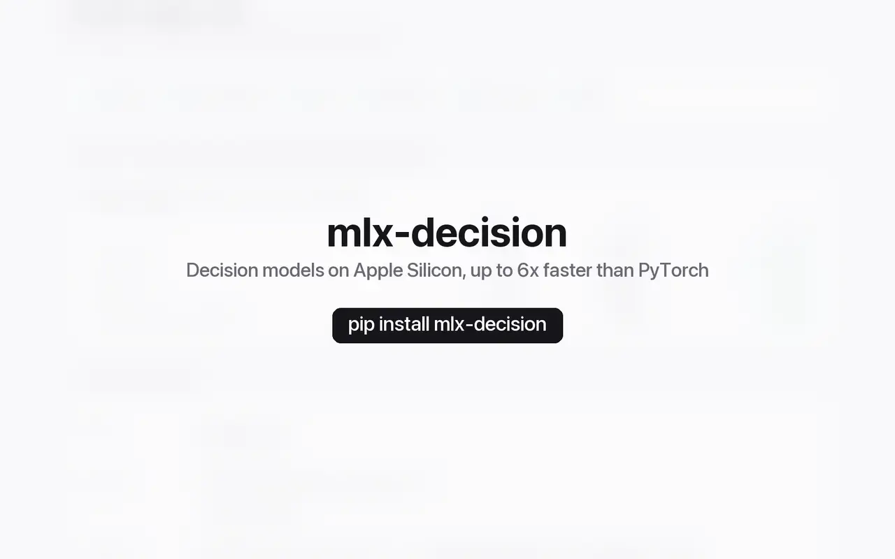

# mlx-decision

Run and fine-tune decision models locally on Apple Silicon with [MLX](https://github.com/ml-explore/mlx).

A decision model reads a *state* (a message, a document, a screenshot,
any JSON) and a set of typed *questions*: pick one of several options,
rate on a scale, or answer yes or no. It returns a probability for every
allowed answer in a single forward pass, without generating text, so an
answer is always one you allowed and comes in a fraction of a second.

mlx-decision is for anyone who classifies, routes, moderates or checks
text and images and wants to do it on their own Mac: no data leaves it,
and there is no per-call cost. The **Studio**, a web app on your Mac,
lets you write questions and try them, compare models, answer a whole
dataset and fit a model to your own examples, without writing code;
developers use it from Python, the command line, a Jev-compatible
server and MCP.



*The Studio on a MacBook Air: a support ticket answered by
pplx-decider-flash-v1.2, the same request compared with d1-3B and
d3-nano, and d3-edge trained on TREC.*

## Quick start

```bash
pip install mlx-decision
mlx-decision web
```

`web` starts the Studio and opens it in your browser. With no models
yet, it asks where models should go and offers three that fit your
Mac's memory; download one, start a question set from a template such
as Support triage, and press Run.

The same from the command line, with a model from Hugging Face
(downloaded on first use, 9 GB):

```bash
mlx-decision run -m perplexity-ai/pplx-decider-flash-v1.2 \
  -s "My card was charged twice this month." \
  --noul "refund=The customer wants money back" \
  --choice "team=billing,technical,sales" \
  --score "anger=calm,annoyed,angry"
```

```
refund (noul): yes, p(yes) 0.872
  █████████████████████

team (choice): billing, confidence 0.90
  billing    0.934  ██████████████████████
  technical  0.059  █
  sales      0.008

anger (score): 2.32 on 1-3, confidence 0.24
   1  0.094  ██                        calm
   2  0.492  ████████████              annoyed
   3  0.414  ██████████                angry

pplx-decider-flash-v1.2 · 147 input tokens
```

And from Python:

```python
import mlx_decision
from mlx_decision import Choice, Noul

model = mlx_decision.load("perplexity-ai/pplx-decider-flash-v1.2")
result = model.decide("My card was charged twice this month.", {
    "team": Choice(criteria={
        "billing": "Payments and refunds",
        "technical": "Bugs and errors",
        "sales": "Plans and pricing",
    }),
    "refund": Noul(instructions="The customer wants money back"),
})
print(result.answers["team"].choice, round(result.answers["refund"].noul, 2))  # billing 0.89
```

## Interfaces

**Studio.** `mlx-decision web`. The Playground holds
question sets with several examples, runs them on one model or compares
up to three, and keeps every run in a history. Batches answer a
dataset's rows and show accuracy, a confusion matrix and how well the
probabilities are calibrated; Training fits a model and reports what it
gained. Get Code turns any request into curl, Python or a command line.
Everything is a plain file in a workspace the command line reads.
[docs/STUDIO.md](https://github.com/armbues/mlx-decision/blob/main/docs/STUDIO.md)

**Command line.** `run` answers one state or a JSON lines file of them,
`chat` one state after another, `download` fetches models (quantized
on the way if you like), `convert` makes 8-bit, 4-bit or mixed-precision
copies, and `benchmark` measures speed on your Mac. Defaults live in
`~/.mlx-decision/config.toml`.
[docs/CLI.md](https://github.com/armbues/mlx-decision/blob/main/docs/CLI.md)

**Python.** `mlx_decision.load` and `model.decide` as above, with
questions as objects or as the API's JSON, whole request bodies, images
as paths or bytes, and the load options of each family.
[docs/PYTHON.md](https://github.com/armbues/mlx-decision/blob/main/docs/PYTHON.md)

**Server.** `mlx-decision server -m MODEL` serves an API compatible with
TypeSafe AI's [Jev](https://typesafe.ai), so clients written for it,
such as its Python SDK, work by changing the base URL. One server can
hold several models within a memory budget and pick one per request.
[docs/SERVER.md](https://github.com/armbues/mlx-decision/blob/main/docs/SERVER.md)

**MCP.** `mlx-decision mcp -m MODEL` gives AI agents a `decide` tool over
the [Model Context Protocol](https://modelcontextprotocol.io), on stdio
or HTTP:
`claude mcp add decision -- mlx-decision mcp -m convaiinnovations/laya`.
[docs/SERVER.md](https://github.com/armbues/mlx-decision/blob/main/docs/SERVER.md#agents-mcp)

**Fine-tuning.** `mlx-decision data` turns a Hugging Face dataset, CSV,
JSONL or Parquet file into labelled examples; `training fit` fits a model
to them in minutes, on the Mac it runs on, and `training eval` compares
it with its base. The result is a small folder that loads like any
model. On TREC, a fit takes d1-3B from 86.6% to 96.4% in 4 minutes on
an M5 Pro.
[docs/TRAINING.md](https://github.com/armbues/mlx-decision/blob/main/docs/TRAINING.md)

## Models

| Model | Size | Input | Memory | Good at |
|---|---|---|---|---|
| Cloudflare's [clef-flash](https://huggingface.co/Cloudflare/clef-flash) | 9B | text, images | 19 GB (8-bit: 11 GB) | knowledge, classification, many options, images |
| Cloudflare's [clef](https://huggingface.co/Cloudflare/clef) | 27B | text, images | 54 GB (8-bit: 32 GB, 4-bit: 19 GB) | as clef-flash, a little better on entailment |
| Perplexity's [pplx-decider-flash-v1.2](https://huggingface.co/perplexity-ai/pplx-decider-flash-v1.2) | 4B | text, images | 9.1 GB (8-bit: 5.1 GB, 4-bit: 3.0 GB) | all questions of a request in one pass; distilled from the 27B |
| Perplexity's [pplx-decider-v1.2](https://huggingface.co/perplexity-ai/pplx-decider-v1.2) | 27B | text, images | 52 GB (8-bit: 29 GB, 4-bit: 17 GB) | as flash, and more accurate |
| vLLM Semantic Router's [d3-flash](https://huggingface.co/vllm-sr/d3-flash) | 9B | text, images | 19 GB (8-bit: 12 GB) | entailment, knowledge, calibrated scores; five more sizes from 0.6B to 27B |
| H2O.ai's [H2O-Lightning-4B](https://huggingface.co/h2oai/h2o-lightning-4b) | 4B | text, images | 13 GB (8-bit: 9 GB, 4-bit: 7 GB) | long states and many questions, calibrated scores |
| LiquidAI's [d1-3B](https://huggingface.co/LiquidAI/d1-3B) | 3B | text, many languages | 12 GB | small and fast, many questions on one state; commercial use limited by its licence |
| [laya](https://huggingface.co/convaiinnovations/laya) | 421M | English text | 1.8 GB | topic classification of English text |
| [laya-typed-decisions](https://huggingface.co/convaiinnovations/laya-typed-decisions) | 421M | English text | 1.7 GB | as laya, tuned for typed decision workflows |
| [laya-multilingual](https://huggingface.co/convaiinnovations/laya-multilingual) | 322M | text, 100+ languages | 1.6 GB | topic classification in many languages |
| Supersonic Labs' [Julia-1](https://huggingface.co/SupersonicLabs/Julia-1) | 144M | text, many languages | 1.4 GB | emotion and routing with 2 to 20 options, long states |

A model loads only if its weights fit the GPU's working set, about
three-quarters of the Mac's memory; the quantized copies are made by
`download` or `convert`. Input limits, speed,
the speedup over each model's own PyTorch code, which copy fits which
Mac and each family's details are in
[docs/MODELS.md](https://github.com/armbues/mlx-decision/blob/main/docs/MODELS.md).

## Accuracy

Five public benchmarks, the complete test split of each (5,270
examples), with the same questions for every model. Jev is TypeSafe
AI's hosted model, for comparison.

| Model | TREC | TweetEval Offensive | ANLI round 3 | OpenBookQA | SST-5 |
|---|---|---|---|---|---|
| clef-flash | **96.8** | 78.1 | 50.8 | 95.4 | 57.6 |
| clef (8-bit) | 96.4 | **81.0** | 55.2 | 95.4 | 57.6 |
| pplx v1.1 (8-bit) | 94.0 | 79.6 | 66.8 | **96.8** | **58.0** |
| d3-flash | 85.8 | 77.7 | 64.3 | 95.2 | 57.2 |
| H2O-Lightning-4B | 85.2 | 76.3 | 59.9 | 84.6 | 57.3 |
| d1-3B | 86.6 | 78.7 | 55.7 | 86.2 | 56.8 |
| laya | 79.0 | 61.9 | 39.5 | 39.2 | 35.1 |
| Julia-1 | 16.0 | 37.9 | 33.2 | 33.2 | 36.7 |
| Jev | 92.8 | 77.3 | **70.2** | 96.0 | 57.2 |

TREC (the kind of answer a question asks for, 6 options), ANLI
(entailment, 3) and OpenBookQA (science, 4) are choices, scored by
accuracy in percent; TweetEval Offensive is a yes/no question, scored
by macro-F1; SST-5 rates sentiment on 5 levels, scored by the accuracy
of the most likely level. Clef and pplx v1.1 are level with Jev or
ahead of it on four of the five; on entailment pplx comes close to Jev,
Clef does not. The
small models are near chance on entailment and science questions, as
their model cards lead one to expect. pplx v1.2 and flash are not
measured yet. Every cell's macro-F1 and calibration error, the other
Laya models and how each model matches its own reference code are in
[docs/BENCHMARKS.md](https://github.com/armbues/mlx-decision/blob/main/docs/BENCHMARKS.md#accuracy).

## Install

Requirements: a Mac with Apple Silicon (M1 or later) and macOS 14 or
newer, Python 3.12 or 3.13 (later versions may work), and the memory the
model needs.

```bash
pip install mlx-decision                    # library, command line, Studio, server, images
pip install "mlx-decision[training]"        # plus datasets from the Hugging Face Hub
pip install "mlx-decision[mcp]"             # plus the MCP server for agents
pip install "mlx-decision[all]"             # both
```

Training needs no extra for CSV and JSONL files; the `training` extra
adds Hub datasets, Parquet files and saved `datasets` folders, in the
Studio and for `data`. The `web`, `server` and `images` extras of
earlier versions are part of the base install now; install lines that
name them still work.

MLX also has builds for Linux and Windows, so pip may install
mlx-decision there, but loading a model stops with an error: the models
run on Apple Silicon only. Installing from source and running the tests
is in
[docs/DEVELOPMENT.md](https://github.com/armbues/mlx-decision/blob/main/docs/DEVELOPMENT.md).

## Documentation

- [STUDIO.md](https://github.com/armbues/mlx-decision/blob/main/docs/STUDIO.md):
  the Studio, page by page, and its workspace's files
- [CLI.md](https://github.com/armbues/mlx-decision/blob/main/docs/CLI.md):
  `run`, `chat`, `download`, `convert`, `benchmark` and the config file
- [PYTHON.md](https://github.com/armbues/mlx-decision/blob/main/docs/PYTHON.md):
  the Python API
- [SERVER.md](https://github.com/armbues/mlx-decision/blob/main/docs/SERVER.md):
  the Jev-compatible server and MCP for agents
- [TRAINING.md](https://github.com/armbues/mlx-decision/blob/main/docs/TRAINING.md):
  training data, the kinds of fit, fitted models and evaluation
- [MODELS.md](https://github.com/armbues/mlx-decision/blob/main/docs/MODELS.md):
  every model family, its limits and which copy fits your Mac
- [BENCHMARKS.md](https://github.com/armbues/mlx-decision/blob/main/docs/BENCHMARKS.md):
  speed, quantization, agreement with the reference code and accuracy
- [STABILITY.md](https://github.com/armbues/mlx-decision/blob/main/docs/STABILITY.md):
  what stays stable until 2.0
- [DEVELOPMENT.md](https://github.com/armbues/mlx-decision/blob/main/docs/DEVELOPMENT.md):
  working on mlx-decision itself
- [CHANGELOG.md](https://github.com/armbues/mlx-decision/blob/main/CHANGELOG.md):
  what changed in each release

## Stability

From 1.0.0, mlx-decision follows [Semantic Versioning](https://semver.org/).
The Python API for answering, the request and response format, MCP's
`decide` tool, the commands and their flags, fitted models, training
files, the config file and the Studio's workspace stay stable until
2.0; the flags of `data` and `training` and the training Python API are
provisional and may change in a minor release. The details are in
[docs/STABILITY.md](https://github.com/armbues/mlx-decision/blob/main/docs/STABILITY.md).
Questions and bug reports go to the
[issue tracker](https://github.com/armbues/mlx-decision/issues).

## Affiliation

mlx-decision is an independent open-source project, not affiliated with or
endorsed by Cloudflare, Perplexity, the vLLM Semantic Router project,
H2O.ai, LiquidAI, TypeSafe AI, Convai Innovations or Supersonic Labs. Its server speaks a request and response format
compatible with TypeSafe AI's public Jev API. Clef and clef-flash
(Cloudflare), pplx-decider (Perplexity), the d3 models (vLLM Semantic
Router), H2O-Lightning (H2O.ai), Laya
(Convai Innovations) and Julia 1 (Supersonic Labs) are used under their
Apache-2.0 licences, d1-3B (LiquidAI) under the LFM Open License v1.0;
this package downloads them from Hugging Face and does not ship their
weights.

## Licence

MIT, see [LICENSE](https://github.com/armbues/mlx-decision/blob/main/LICENSE). The Qwen3.5 and LFM2 model code and the gradient
checkpointing used for fine-tuning are adapted from
[mlx-lm](https://github.com/ml-explore/mlx-lm) (MIT, Apple Inc.); the Clef
input encoding and head are ported from Cloudflare's release; the image
preprocessing, vision tower, image positions and the ModernBERT encoder
are ported from [transformers](https://github.com/huggingface/transformers);
the pplx prompts are ported from pplx-decider's releases (v1.1, and v1.2's
joint request format), the d3 prompt from
d3-flash's; the H2O-Lightning
prompt and the lifting of images out of the state from H2O-Lightning's
release; the d1 prompt and answer reading were written from d1-3B's
documented and observed behaviour, without its release's code; the Laya and Julia
head and input encoding are ported from the
[laya](https://pypi.org/project/laya/) package and Julia 1's release (all
Apache-2.0). The Studio's page ships
[Preact](https://preactjs.com) and
[Preact Signals](https://github.com/preactjs/signals) (MIT) and
[htm](https://github.com/developit/htm) (Apache-2.0). Their licence texts are in `LICENSES/`. The test photos are
public domain or CC0 (`tests/parity/images/SOURCES.md`). Model weights keep
their own licence (Clef, clef-flash, pplx-decider, d3, H2O-Lightning,
Laya, Julia 1: Apache-2.0; d1-3B: LFM Open License v1.0).
