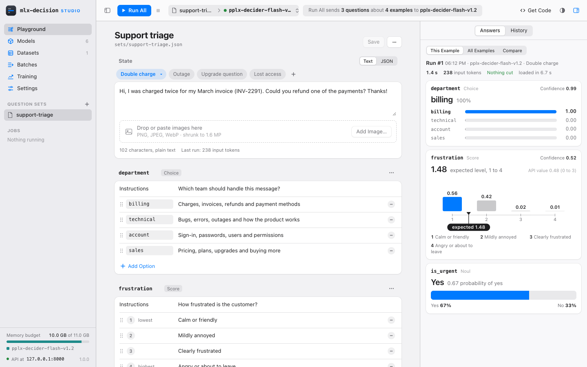
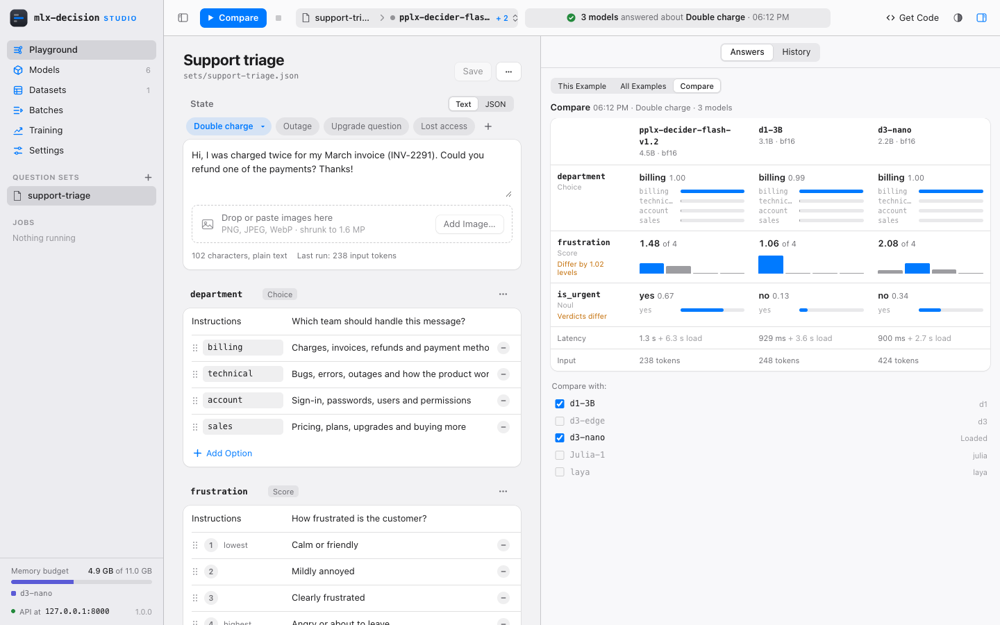
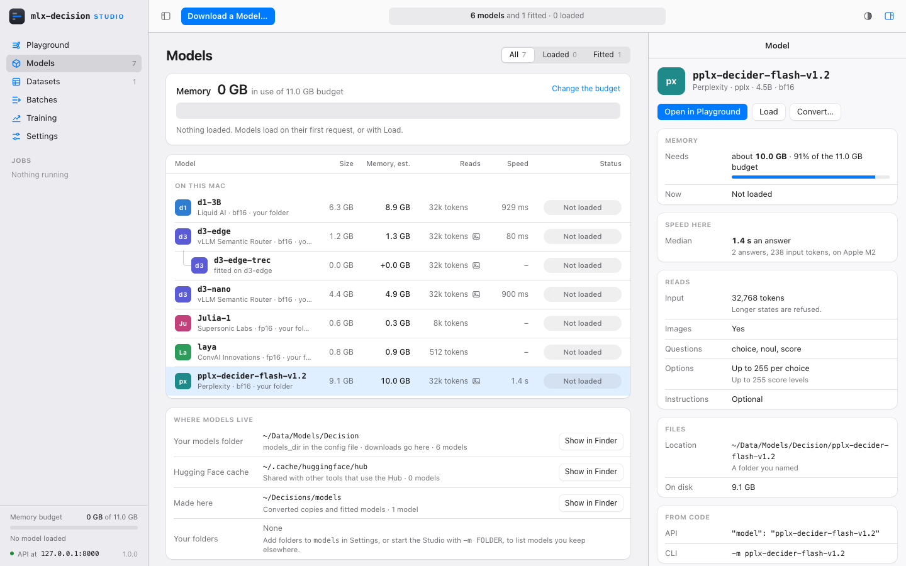
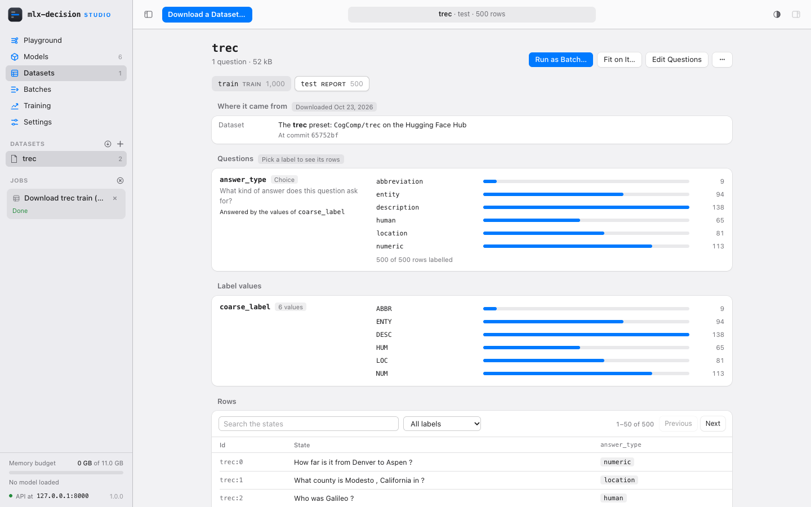
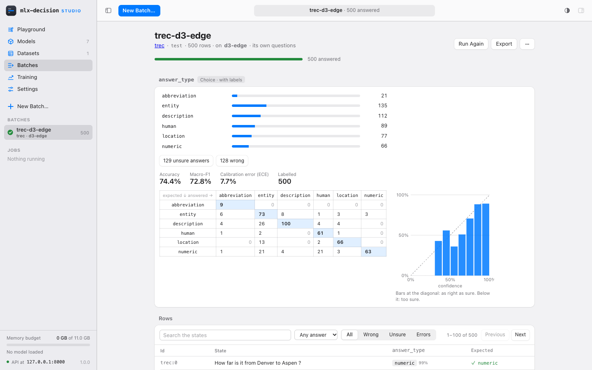
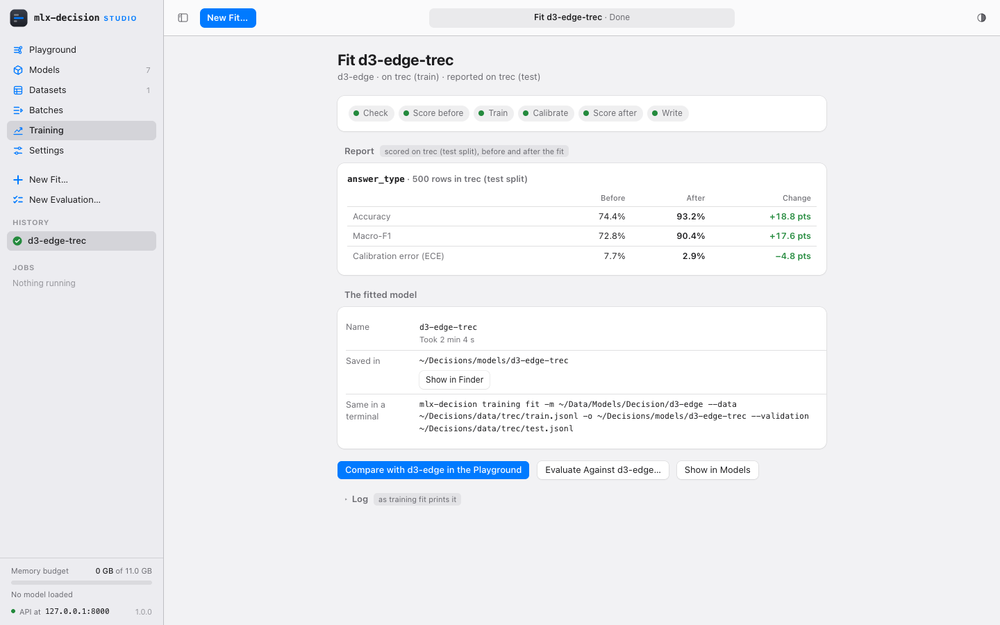

# Studio

The Studio is mlx-decision in the browser. You download a model, write
questions and try them in the Playground, compare models, answer a whole
dataset in a batch, fit a model on your own labelled data and evaluate
it, all without the command line. Everything it makes is a plain file
in its workspace that the command line reads as it is, and every page
shows the command or API call that does the same.

```bash
pip install mlx-decision
mlx-decision web
```

Without a Python 3.12 or newer of your own, install it with
[uv](https://docs.astral.sh/uv/), which brings its own Python, as the
README's [quick start](../README.md#quick-start) shows:
`uv tool install --python 3.13 mlx-decision`. Datasets from the Hugging
Face Hub need the `training` extra as well:
`pip install "mlx-decision[training]"` (with uv:
`uv tool install --python 3.13 "mlx-decision[training]"`).

A few words used throughout: the **state** is what the model reads (a
text, or any JSON value such as a ticket or a conversation), with one or
more **questions**: a choice (one of several options), a score (a level
on an ordered scale) or a noul (yes or no). A **family** is a kind of
model (Clef, pplx, d3, Base Labs, H2O-Lightning, d1, Laya, Julia; see
[MODELS.md](MODELS.md)); each family has its own mark and colour in the
Studio. **Jev** is TypeSafe AI's hosted decision service; the Studio
answers the same API, so Jev's clients work against it. A **token** is
the unit a model reads text in, about three quarters of a word; input
limits count them. A **quantized** copy (8-bit, 4-bit) stores the
weights with fewer bits: less memory, answers close to the original's.
Models come from the **Hugging Face Hub**, where each has a **repo id**
such as `perplexity-ai/pplx-decider-flash-v1.2`; the **Hugging Face
cache** is the folder on your Mac where downloads from it are kept. A
dataset's **splits** are its parts (train, test); **JSON lines** is a
file with one JSON value per line.

- [Your first decision](#your-first-decision): from the first start to
  the first answers
- [Starting it](#starting-it): the first start, other machines, the
  config file
- [The window](#the-window): layout and keys
- [Playground](#playground): question sets, runs, Compare, History, Get
  Code
- [Models](#models): the list, Download, Convert
- [Datasets](#datasets): Download, Add, questions for a dataset
- [Batches](#batches): a dataset's rows answered by a model
- [Training](#training): fits and evaluations
- [Settings](#settings)
- [Jobs and the busy GPU](#jobs-and-the-busy-gpu)
- [The workspace](#the-workspace): its files from a terminal
- [Not in 1.0](#not-in-10)

## Your first decision

1. In Terminal, run `mlx-decision web`. The Studio opens in your
   browser. Keep the Terminal window open while you use it: closing it
   stops the Studio. The address holds a session token that changes on
   every start, so open the Studio this way, not from a bookmark.
2. "Where should models go?": keep the Hugging Face cache unless you
   want the models in a folder of your own.
3. Pick one of the three models offered. Download a Model opens with it
   chosen; press Download. The download shows in the sidebar's Jobs
   list; a model is several GB, so it takes a few minutes.
4. On the Playground, the + by Question Sets (or ⌥⌘N) opens New
   Question Set…: pick Support triage and press Create.
5. Press Run All (⌘↩). The model loads, then answers each example; the
   Answers tab shows a card per question ([Running](#running) says how
   to read them).
6. Change the state or a question and run again; Compare tries the same
   on other models.

## Starting it

`mlx-decision web` starts one process, prints the Studio's address with
a session token and opens it in the default browser (`--no-browser`
leaves it closed; open the printed address yourself). Use Chrome on
macOS: other browsers are not refused, but they are not supported or
tested.

The Studio lists, without loading anything:

- the models `-m` names, or without `-m` the config file's `models` and
  the models in its `models_dir`;
- the models the Studio converted or fitted, in the workspace's
  `models/`;
- the models of the supported families in the Hugging Face cache.

Nothing loads at startup unless there is a default model
(`--default-model`, or the config file's `default_model`); a model loads
on its first request, or with Load on the Models page. `--memory-budget`
caps the memory loaded models may take (by default the GPU's
recommended working set); the least recently used are unloaded to stay
within it. The load options of `run` and `server` (`--max-input-tokens`,
`--max-image-mp`, `--prefix-cache`, `--noul-floor`,
`--no-memory-check`) apply to every model the Studio loads.

The same process also serves the Jev-compatible API of
[`server`](SERVER.md#server) (`POST /v1/systemone`, `GET /v1/models`,
`GET /health`) at the same address, with the same models and memory. An
app you write against the API can run while you use the Studio, and both
are answered one request at a time.

The port is 8000 by default, as for `server` (`--port`); a port in use
is an error, and the Studio does not pick another. Ctrl-C stops it: a
running batch and the jobs are stopped first. The Studio works with the
network off, except for downloads.

### The first start

With no models at all, the Models page opens on "Download your first
model". If the config file has no `models_dir` yet, it first asks
"Where should models go?": a folder (under your home folder) or the
Hugging Face cache, which is preselected. The answer is added to
`config.toml` as `models_dir` and not asked again; Settings changes it
later. Then it offers three models that fit this Mac's memory (a small,
a medium and a large one, picked at random among those that fit), each
with its download size; a pick opens Download a Model with it chosen
(with the memory it needs to run), and
Download a Model… there offers the rest. On a Mac where none fits at
full size, Download a Model offers them quantized.

### From another machine

The Studio answers only on this Mac by default (`127.0.0.1`). `--host`
with another address serves it on the network, and then needs an API
key: `--api-key KEY` or `MLX_DECISION_API_KEY` (without one, `web`
refuses to start and says so). The key guards the Jev API as for
`server`, and a browser on another machine logs in with it: the
address with the token works only from this Mac. Use a long random key
(`python -c "import secrets; print(secrets.token_urlsafe(24))"`).

A browser on another machine can do everything except what touches
this Mac's files directly: Show in Finder, changing the config file on
the Settings page and Clear… are only offered on this Mac.

The Studio checks every request's `Host` and `Origin`, so another web
page in your browser cannot use it or its API, and it needs the session
cookie that the printed address sets.

### The config file

`~/.mlx-decision/config.toml` (or `$MLX_DECISION_HOME/config.toml`)
holds defaults for `web`'s flags as for the other commands:
`models_dir`, `models`, `default_model`, `memory_budget_gb`, `host`,
`port` and `workspace`. A flag wins over the file, the file over the
built-in default. The file's format is in
[CLI.md](CLI.md#defaults-in-a-config-file); the [Settings](#settings)
page shows and changes it.

## The window

The sidebar has the pages (Playground, Models, Datasets, Batches,
Training, Settings), the open page's own list (question sets, datasets,
batches, fits), the Jobs list, the memory in use against the budget, and
at the bottom `API at HOST:PORT` with a status dot (orange "API busy"
while a job has the GPU) and the version. The toolbar has the page's
main action (Run, Download a Model…, Start Fit, …) with its Stop, on
the Playground the open set and the model it runs on, a status field
that says what is selected, running or measured, and the tools (Get
Code, Appearance, the inspector's toggle), with the sidebar's toggle at
its left. The inspector on the right shows what is picked: a run's
answers, a model, a dataset's row. Appearance is Follow the System
(the default), Light or Dark.

Several tabs, and a reload, show the same state: the question sets and
their history come from the workspace, and running jobs come with their
progress so far. Files changed from a terminal show when the tab is
focused again. If the Studio stops answering, the status field and the
sidebar say so within seconds. After a restart, a new session starts:
open the address the Studio printed in a new tab, and then the tabs
already open reconnect by themselves, keeping their edits (the page says
so).

| Key | Does |
|---|---|
| ⌘↩ | the main action: Run, Run All or Compare in the Playground; Start Fit or Start Evaluation on the Training page |
| ⌥⌘↩ | Run This Example, with several examples |
| ⌘D | Download a Model…, on every page |
| ⌥⌘N | New Question Set… (⌘N is Chrome's) |
| ⌘O | Import Questions… |
| ⌘S, ⇧⌘S | Save, Save As… (for a dataset's questions: Save as Question Set…) |
| Esc | close a menu, a sheet or the image preview |

⌥⌘N, ⌘O, ⌘S and ⇧⌘S work on the Playground.

## Playground

The Playground is where questions are written and tried. The sidebar's
Question Sets lists the sets in the workspace's `sets/`. Each set is a
request body (`sets/NAME.json`) with a state, its questions and,
optionally, several examples.



### Question sets

New Question Set… (⌥⌘N, or the + by Question Sets) starts empty or from
a template: Support triage, Review rating, Content moderation, Fact
check, Intent routing, Many languages, Conversation and Screenshot
check, each with a few examples. Save (⌘S) writes the set. Unsaved
edits show as "Edited" (and a dot by the set in the sidebar); they are
kept in the tab while you move to other sets and pages, and closing or
reloading the tab with them asks first. The set's "…" menu
has Save As… (⇧⌘S, the way to copy a set), Rename…, New Question Set…,
Import Questions… (⌘O: a `-q` questions file or a whole request body),
Export (downloads the set's file), Show in Finder and Delete… (which
names the history it deletes too). A set changed on disk while it is
open is not overwritten: the Studio says so and offers Reload or Save
As….

### State and examples

The state is Text or JSON (any JSON value, parsed as you type). For a
model that reads images, the state has a drop area ("Drop or paste
images here", with the model's limits: types, how many, the size they
are shrunk to) and Add Image…. A model that reads text only shows no
drop area; an example that already holds images says the model reads
text only. A thumbnail opens the image large (arrow keys step through
the example's images, Esc closes).

The chips above the state are the set's examples: Example, and + for
another. A chip's menu has Run This Example, Rename, Duplicate, Move
Left, Move Right and Remove Example (a set keeps at least one example). With several examples, Run becomes Run All (⌘↩): it asks
each example in turn and shows a grid of examples by questions. Run This
Example (⌥⌘↩, or the chip's menu) asks only the selected one. The file
keeps the first example as its top-level `state`, so `run -q` and the
API read the set as any request body.

### Questions

Each question is a group: its id, its type and its instructions. A
Choice has options, each an id and a description (Add Option); a Score
has levels in order from lowest to highest (Add Level); a Noul (yes or
no) has optional descriptions When yes and When no. Rows are dragged to
reorder them. Add Question offers the three types; a question's "…"
menu has Move Up, Move Down, Duplicate, the type (changing it keeps
what carries over) and Remove Question.

The line under the questions is the live check, against what the model
the set runs on takes (question types, how many options or levels,
whether instructions are needed, images): "3 questions, within d3-edge's
limits", or the problem at its field. Run is off while a problem is
open. The input's length is checked when the request runs, since it
needs the model's tokenizer.

### Running

The toolbar shows the open set and the model it runs on; its menu has
Run on (the model) and Compare With (up to two more models). Run (⌘↩)
sends the set to the model, loading it first if needed (the status
field says so before you run). The answers show in the inspector's
Answers tab, a card per question (the One Model view; with several
examples, This Example, and All Examples for Run All's grid):

- a choice: the probability of each option, the top one in colour, and
  its confidence;
- a score: a column per level, the expected level marked ("1.67
  expected level, 1 to 3", counted from 1 as people rate) and the value
  the API returns, which counts from 0 ("API value 0.67 (0 to 2)");
- a noul: the probability of yes, as a bar of yes and no.

Confidence, on a choice and a score, is the API's `confidence`: 0 when
the answer is no better than an even guess, 1 when the model is sure.
It is not the probability shown beside the answer: "billing 50%" among
three options has a confidence of 0.25. For a noul, which has no
confidence in the API, the Studio's batches use the probability of the
answer given.

Above the cards: the time the answer took, the input tokens, whether
the state was cut to fit, and whether the model was loaded for it and
how long that took. Editing a question after a run marks it and its
card as edited; focusing a question highlights its card and the other
way round.

### Compare

Compare runs the selected example on two or three models, one after
another (each loading in turn when they do not fit together), and shows
each question's answers side by side. Pick the models in the toolbar's
menu (Compare With) or in the Answers tab's Compare view; fitted models
and their bases are offered too. While models are ticked under Compare
With, the main action is Compare (⌘↩; the target shows "MODEL + 1");
to Run again, untick them and switch the Answers tab away from Compare
(to One Model, or with several examples to This Example or All
Examples). Stop
ends it: the models not asked yet are not run.
A Compare is one History entry.



### History

Every run is kept, in `history/NAME.jsonl`, until you delete it. The
History tab lists the runs (a Run All and a Compare as one entry each),
newest first. Picking a run shows what changed in the questions since
the run before (a word diff of the instructions and options) and, for a
run on one model, a chart of how each answer moved; when its questions
differ from the editor's, Restore These Questions goes back to them. An entry's delete button shows on hover;
Clear History… deletes them all.

### Get Code

Get Code shows the selected example's request as curl, Python (the Jev
SDK), Command Line (`mlx-decision run -q` with the set's path) and MCP
Client (a client's configuration for [`mlx-decision mcp`](SERVER.md#agents-mcp)),
each with this Studio's real address and a placeholder for the key when
one is needed, and Copy. The curl and Python code call the Studio's own
API, so they work while it runs.

### A dataset's questions

A dataset from the Datasets page opens in the Playground with Write
Questions (or Edit Questions once it has some). The open document is
then the dataset, and the editor edits its questions: Save writes them
to the dataset's `dataset.json`. In place of the example chips it shows
a sample of the dataset's rows (about two per label value, with Shuffle
and a search); the rows' states are shown, not edited. Each question
has "Answered by", the column whose values are its labels (or none: the
question is asked, not trained), and for each of the column's values
the answer it stands for ("Answer for VALUE": an option, a level, yes
or no, or Leave out). A new choice whose column is set gets an option
per value at once; Options from Values does it again, naming the
options from the column's names (a class label's names, the dataset
card's, or Paste Names…). Several values can stand for one option. Run All asks the rows shown and adds
each row's expected answer and the agreement per question, a baseline
before any fit. Start from a Question Set copies a set's questions in;
Save as Question Set copies them, with the rows shown as examples, into
`sets/`.

## Models

The Models page lists every model the Studio knows, grouped Loaded, On
this Mac and Downloading, with fitted models under their base and the
filters All, Loaded and Fitted. Each row has the family's mark, the
name and where it came from, the size on disk, the memory it needs
(estimated), what it reads (its input limit, and an image mark when it
reads images), its speed on this Mac and its status: Loaded (with when
it was last used), Not loaded, Over budget (it needs more than the
memory budget, so it cannot load until the budget is raised),
Downloading or Converting.
The status turns into Load or Unload under the pointer. A row's context
menu has Open in Playground, Load or Unload, Convert…, Copy Name and,
for a model the Studio made, Delete….



The memory card above the list shows the memory in use against the
budget. Pointing at a model previews what loading it would do,
including which models would be unloaded to make room. Change the
budget opens Settings.

The inspector shows the picked model: Open in Playground, Load or
Unload, Convert…; the memory it needs and its state now; its speed here
(the median of its measured requests, or "Not measured yet"); what it
reads (input limit, images, question types, options, whether
instructions are needed); its files and where they came from, with the
family's licence note; the fitted models made from it; and how to name
it from code (`"model": "NAME"` in the API, `-m ...` on the command
line).

Delete… removes a model the Studio converted or fitted (in the
workspace's `models/`), after asking, unloading it first. It is off for
the default model and for a model that fitted models are made from, and
refused while a job or a batch uses it. Downloaded models are not
deleted from the Studio: delete the folder, or for the Hugging Face
cache `hf cache rm model/ORG/NAME`.

Where models live, under the list, names the places models come from,
each with its path, how many models it holds and Show in Finder: the
Hugging Face cache, the workspace's `models/` ("Made here") and your
own folders (`models_dir` and the config file's `models`, or `-m`).

### Download a Model

Download a Model… (⌘D, on every page) opens a sheet with the families,
then the picked family's models with their sizes, then for Clef, pplx,
d3, Base Labs and H2O-Lightning Download as Original, 8-bit or 4-bit (each with its
size and whether it fits: within the memory budget, over it (it would
not load until the budget is raised) or too large for this Mac), as
[`download`](CLI.md#getting-a-model-download) offers them. A model with
its own terms of use (d1-3B) shows them before it downloads. Other repo
id takes any repository of a supported family on the Hugging Face Hub
(Check first). The
sheet says where the model goes: into `models_dir`, or the Hugging Face
cache. An 8-bit or 4-bit copy is quantized as it downloads: the
full-size files are fetched one at a time, quantized and deleted, so
only the copy is kept, where the full-size model would have gone.

A download is a job without the GPU: several can run at once, while
you use the rest of the Studio. It shows in the Downloading group and
the Jobs list with its progress and Stop; a stopped download leaves no
half model behind. The model joins the list when it is complete.

### Convert

Convert… (in the inspector and a row's menu) writes an 8-bit or 4-bit
copy of a Clef, pplx, d3, Base Labs or H2O-Lightning model into the workspace's
`models/`, as [`convert`](CLI.md#quantizing-convert) does, with its
estimated size and a name (by default the model's with `-q8` or `-q4`).
A conversion holds the GPU while it runs ([Jobs](#jobs-and-the-busy-gpu)).
Mixed precision is only on the command line.

## Datasets

A dataset is labelled rows: states with the right answers to one or
more questions. Fits, evaluations and batches read them from the
workspace's `data/`, each a dataset folder (a `dataset.json` with the
questions and one JSON-lines file per split) or a single JSON-lines
file. The formats are in [TRAINING.md](TRAINING.md#training-data).



The sidebar lists them, with Download (the arrow) and Add (+) in its
heading and a delete button on each row on hover (refused while a job
reads the dataset). A dataset without questions, or with values no
option stands for, is marked.

### Download a Dataset

Download a Dataset… turns a public dataset into a dataset folder, as
the [`data`](TRAINING.md#data-datasets-to-training-files) command does
(the Hub needs the `training` extra). The sheet offers the five
benchmark datasets (TREC, TweetEval Offensive, SST-5, OpenBookQA, ANLI
round 3), each with its question and options, or Another dataset… for
any dataset on the Hub: a preview of its columns and rows, then its
shape, one or several columns as the state and one column of labels
(the dataset then arrives without questions, which you write in the
Playground), or multiple choice (a question, choices and answer column,
whose instructions you write in the sheet).

Each split gets a role: Train (what a fit learns from), Report (rows a
fit does not learn from, which its before-and-after report scores),
Evaluate (rows kept for New Evaluation, which no fit sees) or Leave
out, with an optional random sample of N rows, or Cut into parts
(shares for train, report and evaluate, stratified by label). The download is a job
without the GPU, with progress and Stop; the dataset's `dataset.json`
records where it came from.

### Add a Dataset

Add (+) takes a file from your Mac into `data/` under a name:

- a JSON-lines file of labelled examples (training lines: a request body
  and its `labels`), checked as `training fit` checks it; when lines do
  not read as training lines, the sheet lists the problems by line and
  offers Add as Rows… to read the file as columns instead;
- a CSV or JSON-lines file of columns, without questions: you pick the
  state column and the label column, as for Another dataset…, and write
  the questions in the Playground.

An added file is a dataset of one split, `train`, with the role Train;
a fit then reports on a share of it kept aside.

### A dataset

Picking a dataset shows its splits as tabs, each with its role and
count, and for the shown split:

- its actions: Run as Batch…, Fit on It… (the Training page with the
  dataset picked), Write Questions or Edit Questions (the Playground on
  the dataset; a single JSON-lines file, whose questions are in its
  lines, has New Question Set from It instead), and in "…" Evaluate on
  It…, Show in Finder and Delete…;
- its questions with each label's count (pick a label to see its rows);
- its rows, paged, filtered by label and searched in the states;
  picking one shows it whole in the inspector;
- its files, with the commands that read them
  (`mlx-decision training fit -m MODEL --data ...`).

A dataset without questions, or with values no option stands for, has
a banner that says what is missing, and Fit on It… and Evaluate on It…
offer Write Questions instead of the form.

## Batches

A batch answers a dataset's rows with a model and, where the dataset
has labels, shows how often the model is right. New Batch… (on the
Batches page, or Run as Batch… on a dataset) asks for:

- the dataset and split;
- the rows: all of them, or a random sample of N with a seed;
- the questions: the dataset's own, or a question set's from the
  Playground (needed for a dataset without questions); the sheet says
  which of them its labels score;
- the model, and the batch's name (by default the dataset's and the
  model's).

A batch runs in the Studio's process, one row at a time on the same
worker as the Playground and the API, which are answered between two
rows. Its model stays loaded while it runs. Only one batch runs at a
time, and it does not run beside a GPU job ([Jobs](#jobs-and-the-busy-gpu)).
Its progress (rows answered and the time left) shows on the page and in
the Jobs list, each with Stop; a stopped batch keeps what it answered.



The page shows what the batch ran (dataset and split, questions, model),
how far it got or how it ended, and its results:

- with labels, per question the metrics `training eval` reports
  (accuracy, macro-F1, calibration error, and the mean error for a
  score), a confusion matrix and a reliability diagram (how often
  answers at each confidence are right); without labels, the answers
  only;
- the rows, a line each with the state, every question's answer with
  its probability and, with labels, the expected answer; filtered by an
  answer, by Wrong, by Unsure (a [confidence](#running) below 0.6) or
  by Errors (rows the model refused), searched in the states, paged. Picking a row
  shows it whole in the inspector, with each answer's probabilities.

Its actions: Run the Rest (the rows a stopped batch did not answer),
Run Again (a new batch of the same rows, questions and model), Export
(CSV with the columns `id`, `state`, then per question its answer,
`QUESTION_confidence` and, with labels, `QUESTION_expected`, and
`error`; or JSON Lines, the lines `run --states --json` prints, each
with the row's `id`), Save Answers as a Dataset…, Copy Command, Show
in Finder and Delete….

Save Answers as a Dataset… makes a new dataset in `data/` from the
batch: its questions, and each row's top answers as labels, optionally
only answers with a [confidence](#running) of at least a threshold (a
row left with no label is left out). One model's
answers can so become the training data of another.

From a terminal, in the workspace, `mlx-decision run -m MODEL -q
batches/NAME/questions.json --states batches/NAME/rows.jsonl --json`
answers the same rows. Copy Command gives the whole line, starting with
`cd` into the workspace and naming the model's folder.

## Training

The Training page fits a model on a dataset and evaluates models. Its
sidebar has New Fit… and New Evaluation…, then the History of fits and
evaluations, newest first with the running one on top. Picking one
shows its progress or its report; an ended one has a delete button on
hover (for a fit, ticking the model deletes it too). What each kind of
fit does, and what it gains, is in [TRAINING.md](TRAINING.md).



### New Fit

The form, from top to bottom:

- **Data**: the dataset (or Fit on It… on the Datasets page); Report on,
  what the report scores: a share of this dataset kept aside, a split
  of it, or another dataset (with the same questions); the split bar
  (rows to train on; rows to tune on, which pick the best epoch and
  tell when to stop early; rows kept aside for the report);
  the labels with their counts, and warnings such as too few examples
  for an option.
- **Base model**: the model to fit.
- **Method**: the kinds the base model's family can learn, each a card
  with its memory at the peak (an estimate) and whether that fits this
  Mac; the one `--method auto` would take is marked Recommended.
- **Result**: Save as, the fitted model's name in the workspace's
  `models/`; Options: the epochs, whether to stop early when the
  tuning rows get worse, and the seed.

Start Fit (⌘↩) starts it as a job that holds the GPU. While it runs,
the page shows its stages (Check, Score before, Train, Calibrate, Score
after, Write, as its kind goes through them), the step with the measured
time left, the loss where the kind reports one, and the log as
`training fit` prints it.

The report shows, per question, Before, After and Change on the rows
kept aside (accuracy, macro-F1, calibration error, the change in
points), the kept epoch ("Kept epoch 3 of 4"), how long it took, and
The fitted model: its name, where it was saved (Show in Finder) and
Same in a terminal, the command that does the same. Its buttons:
Compare with BASE in the Playground (the fitted model and its base on
the dataset it learned from; Open in Playground when it learned from a
single file), Evaluate Against BASE… and Show in Models. The fitted
model shows in Models and the Playground as soon as it is written. If
its folder was deleted, the report says so and offers Delete Entry….

### New Evaluation

New Evaluation (also Evaluate on It… on a dataset, or Evaluate Against
… on a fit's report) scores a model on labelled rows, alone or against
another: the model, Compare with (another model or none; for a fitted
model its base, to see what the fit changed), the dataset and split
(its evaluate split preselected), and the questions it scores. Start
Evaluation runs `training eval` as a job that holds the GPU, loading
the models one at a time; the report puts both models side by side with
the differences. When the rows are the ones a fitted model learned
from, the Studio warns that the evaluation includes its training data.

## Settings

The Settings page shows the config file (its path, with Show in Finder;
"Not created yet: a change creates it") and its seven keys: the value
the Studio uses, where it comes from (a flag, the file, or built in),
and Change…, whose sheet sets a new value or, for a key in the file,
Take Out of the File. A change is written to the file at once, one
line, keeping the rest of the file as it is.

| Setting | Key | Takes effect |
|---|---|---|
| Where models go | `models_dir` | now (downloads go there, its models are listed) |
| Other models | `models` | now for models added, at the next start for models taken out |
| Default model | `default_model` | now |
| Memory budget | `memory_budget_gb` | now |
| Address | `host` | at the next start |
| Port | `port` | at the next start |
| Workspace | `workspace` | shown, not changed here: it moves with `--workspace` or the file, at the next start |

A key that a flag set for this run takes effect at the next start
without the flag; the page says which. Only a browser on this Mac
changes the file.

Below, the workspace's folders (`sets/`, `history/`, `data/`,
`batches/`, `models/`, `jobs/`, `speed/`), each with what it holds, how
many entries and their size, Show in Finder and Clear…. Clear… deletes
everything in the folder, after asking, as deleting each entry would (a
set with its history, a model unloaded first). It is refused while
something in the folder is in use; for `jobs/`, the jobs that have not
ended stay.

## Jobs and the busy GPU

Downloads, conversions, fits and evaluations run as jobs: each one is
the `mlx-decision` command (`download`, `convert`, `training fit`,
`training eval`, `data`) run by the Studio with `--events`, its files in
the workspace's `jobs/`. The sidebar's Jobs list shows each with its
progress and Stop; its title links to what it made. An ended job stays
in the list until you close it (its ×, or the clear button in the
heading for every ended one).

- **Downloads** (of models and datasets) do not need the GPU: several
  run at once, beside everything else.
- **Conversions, fits and evaluations** hold the GPU. A job waits for the
  request the GPU is on, then every model is unloaded and the job runs
  alone. Until it ends, every page says so: a banner naming the job,
  with Stop; Run, Run All, Compare, Load and Unload are off; and the API
  answers 503 "busy", naming the job, with `Retry-After`. Afterwards
  models load again on their next request. One such job runs at a time:
  Start Fit, Start Evaluation, Convert… and a batch's Start are off
  while one runs, naming it.
- **Batches** are not jobs (they run in the Studio's process) but are
  listed with them. A batch does not start while a GPU job runs or
  waits, and a GPU job started while a batch runs is refused with a
  message naming the batch; nothing is queued.

Stop interrupts the job: the command stops at its next step and writes
nothing. If it does not end, a second interrupt follows after 20 s, then
it is killed, and what a killed write leaves behind is removed. A job's
outcome is its last event: done, error or cancelled. When the Studio
stops (Ctrl-C), it stops its jobs first, and they end interrupted. When
the Studio is killed, its jobs notice and stop within seconds, writing
nothing.

## The workspace

The workspace is the folder that holds what the Studio makes:
`~/.mlx-decision` by default (`MLX_DECISION_HOME` moves it, with the
config file), or the folder `--workspace` or the config file's
`workspace` names (the config file stays in `~/.mlx-decision`). It is
created on the first start, with a `README.md` that lists the folders.
Each file is a plain file in a format the command line reads as it is,
written whole (to a temporary file, then renamed).

| Path | Holds | From a terminal |
|---|---|---|
| `sets/NAME.json` | a question set: a request body (`state`, `questions`, images as data URLs, and `examples` when there are several) | `mlx-decision run -m MODEL -q sets/NAME.json` answers it as the Studio does |
| `history/NAME.jsonl` | the Playground's runs of a set, a line per run: request, model, answers, timings (a dataset's: `history/datasets/`) | any JSON-lines reader |
| `history/images/` | each image of the history once, named by its SHA-256 | |
| `data/NAME/`, `data/NAME.jsonl` | datasets: a folder with `dataset.json` and a JSON-lines file per split, or one JSON-lines file | `mlx-decision training fit -m MODEL --data data/NAME` |
| `batches/NAME/` | a batch: `batch.json` (what it ran, how far it got), `questions.json`, `rows.jsonl`, `results.jsonl` (a line per row answered) | `mlx-decision run -m MODEL -q batches/NAME/questions.json --states batches/NAME/rows.jsonl --json` |
| `models/NAME/` | models the Studio converted or fitted | `mlx-decision run -m models/NAME` |
| `jobs/ID/` | a job: `job.json` (the command, times, outcome), `events.jsonl`, `stderr.log` | |
| `speed/` | how long requests took on this Mac, per model (the latest 1,000 each); the Models page's Speed | |
| `workspace.json` | the version of the layout, `{"format": 1}` | |
| `studio.lock` | held by the Studio using the workspace | |

Two Studios do not share a workspace: a second `web` on the same folder
refuses to start, naming the address of the one using it. A Studio
older than the workspace's format refuses to open it, rather than
change files it does not know; a later Studio brings an older workspace
up to date. `--workspace` takes an empty folder or an existing
workspace, and refuses any other folder that is not empty, so the
Studio does not write into a project by mistake. On start, the Studio
removes leftovers of writes that did not finish and marks jobs that were
running when it stopped as interrupted.

Files you change from a terminal show in the Studio when its tab is
focused again; a question set open in the Playground is not overwritten
(see [Question sets](#question-sets)).

## Not in 1.0

- Browsers other than Chrome on macOS are not supported.
- One GPU job at a time, and no queue.
- Downloaded models are not deleted from the Studio (delete the folder,
  or `hf cache rm` for the Hugging Face cache).
- Convert offers 8-bit and 4-bit, not mixed precision
  ([`convert --target-bits`](CLI.md#quantizing-convert)).
- Datasets and batches hold no images yet; image questions are for the
  Playground.
- Rows are not labelled by hand in the Studio; Save Answers as a Dataset
  labels them with a model's answers.
- No speed or accuracy benchmark page: `mlx-decision benchmark`
  ([CLI.md](CLI.md#measuring-speed-benchmark)) measures speed.
- MCP is a process of its own: [`mlx-decision mcp`](SERVER.md#agents-mcp).
- No secrets in the config file: the API key is a flag or
  `MLX_DECISION_API_KEY`.
- History diffs say that an image changed, not how.
